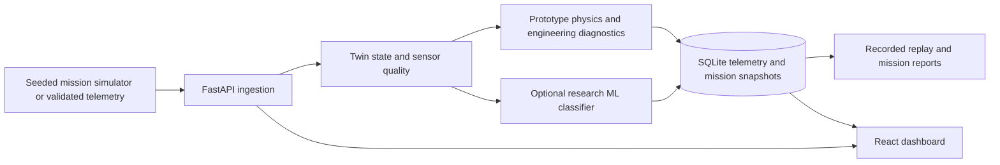

# AERION / AERO-TWIN

AERION is a local aircraft-engine digital-twin **research demonstrator**. It combines generated engine telemetry, validated FastAPI ingestion, prototype physics and engineering diagnostics, an optional scikit-learn fault classifier, SQLite history, and a React/Three.js dashboard. Its data and thresholds are simulated; it is not flight-certified or suitable for operational decisions.

## Architecture



Python 3.13, Node.js 22, and npm are the supported development prerequisites. The Windows launcher installs Python and frontend dependencies when needed. For manual setup and environment variables, see the [backend](backend/README.md) and [frontend](frontend/README.md) guides. SQLite is initialized automatically at backend startup; no external database or hardware is required.

## Start the application on Windows

From PowerShell in the repository root:

```powershell
cd 'D:\projects D\aircraft'
.\run_project.bat
```

The launcher uses `.venv` (creating and installing dependencies if needed), starts FastAPI at `http://127.0.0.1:8000`, waits for `/api/v1/ready`, and starts Vite at `http://127.0.0.1:5173`. Open `/twin` for the digital twin or `/diagnostics` for fault results and saved history. The local launcher enables a bundled dataset feed; demo mode does not require sign-in. Press Ctrl+C in its terminal to stop the services. Existing accounts in `backend/runtime/local-development.db` are preserved.

The default is **engineering-rule fallback**, with `AERION_ENABLE_ML_DIAGNOSTICS=0`. To inspect the existing model in an explicitly labelled **research-only** mode, set both flags before starting the launcher:

```powershell
$env:AERION_ENABLE_ML_DIAGNOSTICS='1'
$env:DIGITAL_TWIN_ML_ALLOW_UNVALIDATED='true'
.\run_project.bat
```

The model must load in the repository `.venv`, which has the artifact's recorded scikit-learn 1.9.1. If loading or compatibility checks fail, `/api/v1/ready` reports ML unavailable while the engineering fallback remains usable. Research mode is refused in production. To return to fallback mode, set `AERION_ENABLE_ML_DIAGNOSTICS='0'` and restart.

For a separate-terminal setup, custom database path, or direct telemetry POST, see the [backend guide](backend/README.md). For the current dashboard and build instructions, see the [frontend guide](frontend/README.md).

## What the dashboard reports

- **Engineering result:** the legacy `predicted_fault`, health, RUL proxy, and fault cards come from prototype rules, physics, and sensor fusion.
- **Research ML result:** when explicitly enabled and ready, `diagnostic_result` gives the trained model's class, version, and *uncalibrated model score*. The UI labels its source `ml_research`. It does not turn the engineering score or RUL into a model probability.
- **Fallback or unavailable result:** the same field identifies engineering rules when ML is off or cannot load, and marks a diagnosis unavailable for stale or invalid required telemetry. The dashboard can fetch bounded diagnostic history from SQLite.

There are two separate research classifiers:

| Model | Data and labels | Saved result | Runtime status |
| --- | --- | --- | --- |
| `live-telemetry-v1` candidate | Dataset v1; nine historical fault classes | Accuracy 0.671 validation, 0.699 challenge, 0.616 time-forward | Explicit development override only; **fails** the unchanged 0.80 per-fault recall release gate. |
| `severity-v4` scenario classifier | Runtime simulator; ten scenario classes | Accuracy 0.9508 validation, **0.9528 synthetic challenge**, macro F1 0.9546 challenge | Separate opt-in endpoint for saved ten-minute, five-second missions; never enabled in production. |

The scenario result measures recognition of this application's generated patterns. It is **not** real UAV fault-detection accuracy and does not promote the historical model. Stage 6 Candidate B remains blocked by the [independent audit](backend/model_evaluation/outputs_stage6/stage6_independent_audit.md). All model scores are uncalibrated; see the [evaluation guide](backend/model_evaluation/README.md) for split details and limitations.

The scenario artifact is a **local runtime file** and is not published with the repository. A fresh checkout starts in engineering mode; generate the artifact in a new `backend/runtime/scenario_model/` directory with the command in the evaluation guide before enabling that research endpoint. The historical dataset and evaluation artifacts are preserved separately.

New simulated missions save their exact telemetry and results in SQLite schema v4. The optional scenario endpoint stores its complete prediction response by mission, model checksum, and input checksum. Replay sessions use recorded samples and clearly label current-rule diagnostics as re-analysis. For older configuration-only missions, the API labels replay as regenerated because the original samples were not saved. Mission IDs cannot be reassigned to a different configuration.

## Verify locally

```powershell
cd 'D:\projects D\aircraft'
.\.venv\Scripts\python.exe -m pytest backend/tests/test_application_pipeline.py backend/tests/test_api.py backend/tests/test_ml_diagnostics.py -q
cd frontend
npm.cmd test
npx.cmd tsc --noEmit
npm.cmd run build
```

The full historical Python suite spans two scikit-learn environments: the live model requires 1.9.1, while two experimental feature tests assert 1.7.2. The latest complete local checks are in the [engineering upgrade record](ENGINEERING_UPGRADE_REPORT_2026-10-11.md): 118 applicable backend tests, 2 version-specific tests, 3 frontend tests, and 7 browser acceptance tests passed. See the [backend guide](backend/README.md) for exact current commands. Dataset validation can be run read-only as described in the [dataset guide](backend/dataset/README.md). **Do not run dataset generation or offline evaluators against their default output directories merely to verify startup:** those commands can overwrite historical artifacts.

The [software CI workflow](.github/workflows/ci.yml) runs backend, dataset, frontend, and separate scikit-learn 1.7.2 experimental checks. A green run is a software correctness signal; it does not promote the failed ML release gate. The original dataset files and evaluation outputs remain historical evidence.

The [engineering upgrade record](ENGINEERING_UPGRADE_REPORT_2026-10-11.md) lists the implementation, exact verification results, and important remaining limits.

Useful endpoints: `http://127.0.0.1:8000/docs` for OpenAPI, `/api/v1/health` for liveness, `/api/v1/ready` for database/adapter/ML readiness, and `/api/v1/model/report` for stored evaluation results. The [demo guide](DEMO_GUIDE.md) walks through the application, including the distinction between engineering and research ML output.

## Documentation map

| Need | Start here |
| --- | --- |
| Quick demonstration | [Judge demo guide](DEMO_GUIDE.md) or [beginner walkthrough](demosnatrate.md) |
| Backend setup, API, authentication, research inference | [Backend README](backend/README.md) and [security guide](backend/SECURITY.md) |
| Frontend setup and data flow | [Frontend README](frontend/README.md) and [workspace guide](frontend/WORKSPACE.md) |
| Dataset provenance and label meanings | [Dataset README](backend/dataset/README.md), [label specification](backend/dataset/LABEL_SPECIFICATION.md), and [scenario mapping](backend/app/SCENARIOS.md) |
| ML protocols, metrics, and release limits | [Model evaluation README](backend/model_evaluation/README.md) and [Stage 6 independent audit](backend/model_evaluation/outputs_stage6/stage6_independent_audit.md) |
| Physics and visualization assumptions | [Physics assumptions](backend/app/PHYSICS_MODEL.md), [fault visualization](FAULT_VISUALIZATION.md), and [model replacement slots](frontend/public/models/README.md) |
| Chronological changes and verified checks | [Engineering upgrade record](ENGINEERING_UPGRADE_REPORT_2026-10-11.md) |

Older milestone, audit, and evaluation-output Markdown files are historical evidence. Their test counts and repository-state statements describe their original dates; use the current guides above for startup and present behavior. The [technology stack](techstach.md) describes implemented components in more detail.
