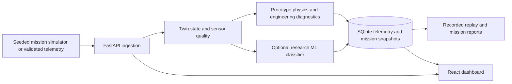

# AERION / AERO-TWIN

AERION is a local aircraft-engine digital-twin **research demonstrator**. It combines generated engine telemetry, validated FastAPI ingestion, prototype physics and engineering diagnostics, an optional scikit-learn fault classifier, SQLite history, and a React/Three.js dashboard. Its data and thresholds are simulated; it is not flight-certified or suitable for operational decisions.

## Architecture



Python 3.13, Node.js 22, and npm are the supported development prerequisites. The Windows launcher installs Python and frontend dependencies when needed. For manual setup and environment variables, see the [backend](backend/README.md) and [frontend](frontend/README.md) guides. SQLite is initialized automatically at backend startup; no external database or hardware is required.

## Start the application on Windows

From PowerShell in the repository root:

```powershell
cd 'D:\projects D\aircraft'
.\run_project.bat
```

The launcher uses `.venv` (creating and installing dependencies if needed), starts FastAPI at `http://127.0.0.1:8000`, waits for `/api/v1/ready`, and starts Vite at `http://127.0.0.1:5173`. Open `/twin` for the digital twin or `/diagnostics` for fault results and saved history. The local launcher enables a bundled dataset feed; demo mode does not require sign-in. Press Ctrl+C in its terminal to stop the services. Existing accounts in `backend/runtime/local-development.db` are preserved.

The default is **engineering-rule fallback**, with `AERION_ENABLE_ML_DIAGNOSTICS=0`. To inspect the existing model in an explicitly labelled **research-only** mode, set both flags before starting the launcher:

```powershell
$env:AERION_ENABLE_ML_DIAGNOSTICS='1'
$env:DIGITAL_TWIN_ML_ALLOW_UNVALIDATED='true'
.\run_project.bat
```

The model must load in the repository `.venv`, which has the artifact's recorded scikit-learn 1.9.1. If loading or compatibility checks fail, `/api/v1/ready` reports ML unavailable while the engineering fallback remains usable. Research mode is refused in production. To return to fallback mode, set `AERION_ENABLE_ML_DIAGNOSTICS='0'` and restart.

For a separate-terminal setup, custom database path, or direct telemetry POST, see the [backend guide](backend/README.md). For the current dashboard and build instructions, see the [frontend guide](frontend/README.md).

## What the dashboard reports

- **Engineering result:** the legacy `predicted_fault`, health, RUL proxy, and fault cards come from prototype rules, physics, and sensor fusion.
- **Research ML result:** when explicitly enabled and ready, `diagnostic_result` gives the trained model's class, version, and *uncalibrated model score*. The UI labels its source `ml_research`. It does not turn the engineering score or RUL into a model probability.
- **Fallback or unavailable result:** the same field identifies engineering rules when ML is off or cannot load, and marks a diagnosis unavailable for stale or invalid required telemetry. The dashboard can fetch bounded diagnostic history from SQLite.

The integrated model is the existing Dataset v1 `live-telemetry-v1` candidate, selected for its compatibility with live API fields. It **fails** the unchanged release gate of at least 0.80 recall for every required fault class on every required partition. The saved evaluation's lowest required-fault recalls are 0.021 on validation, 0.119 on challenge, and 0.000 on time-forward. A high displayed model score is not evidence of a safe engine or a calibrated probability. Stage 6 Candidate B remains blocked by the [independent audit](backend/model_evaluation/outputs_stage6/stage6_independent_audit.md) and is not connected to runtime diagnostics.

An 85–95% accuracy target has not been demonstrated. The live candidate's held-out accuracies are 0.671 on validation, 0.699 on challenge, and 0.616 on time-forward data. These are synthetic-data results; the per-fault recall gate is the binding safety check. Do not advertise or deploy this classifier as a validated UAV diagnostic model. The application can still be run locally as a research demonstrator with engineering diagnostics.

New simulated missions save their exact telemetry and results in SQLite schema v4. Replay sessions use recorded samples and clearly label current-rule diagnostics as re-analysis. For older configuration-only missions, the API labels replay as regenerated because the original samples were not saved. Mission IDs cannot be reassigned to a different configuration.

## Verify locally

```powershell
cd 'D:\projects D\aircraft'
.\.venv\Scripts\python.exe -m pytest backend/tests/test_application_pipeline.py backend/tests/test_api.py backend/tests/test_ml_diagnostics.py -q
cd frontend
npm.cmd test
npx.cmd tsc --noEmit
npm.cmd run build
```

The full historical Python suite spans two scikit-learn environments: the live model requires 1.9.1, while two experimental feature tests assert 1.7.2. See the [implementation and test record](backend/PHASE2_IMPLEMENTATION_REPORT.md) for the matching-environment commands and measured outcomes. Dataset validation can be run read-only as described in the [dataset guide](backend/dataset/README.md). **Do not run dataset generation or offline evaluators against their default output directories merely to verify startup:** those commands can overwrite historical artifacts.

The [software CI workflow](.github/workflows/ci.yml) runs backend, dataset, frontend, and separate scikit-learn 1.7.2 experimental checks. Its green status is a software correctness signal; it does not promote the failed ML release gate. The original dataset files and evaluation outputs remain historical evidence.

The [engineering upgrade record](ENGINEERING_UPGRADE_REPORT_2026-10-11.md) lists the implementation, exact verification results, and important remaining limits.

Useful endpoints: `http://127.0.0.1:8000/docs` for OpenAPI, `/api/v1/health` for liveness, `/api/v1/ready` for database/adapter/ML readiness, and `/api/v1/model/report` for stored evaluation results. The [demo guide](DEMO_GUIDE.md) walks through the application, including the distinction between engineering and research ML output.
